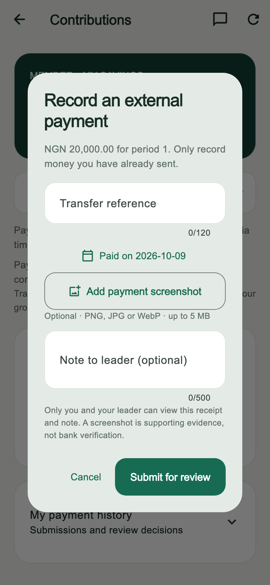
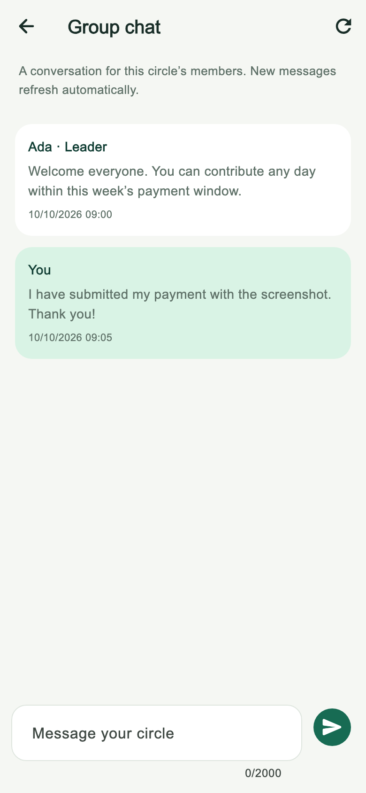
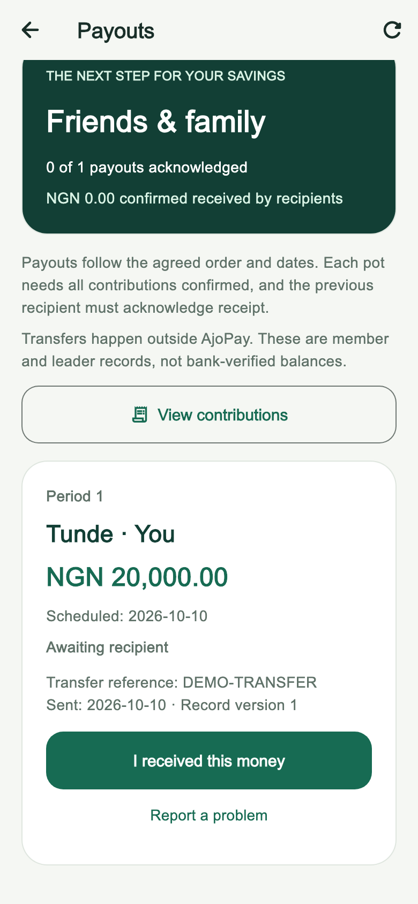

# AjoPay demo and acceptance guide

## The story to demonstrate

AjoPay helps a private savings circle agree to a plan, track externally made contributions, review evidence, and acknowledge payouts. It supports rotating ajo/esusu and saving until an end date. It does not collect, hold, transfer, or invest money.

Use two test accounts and a clearly named **DEMO** group. Use synthetic payment references and a non-sensitive demo screenshot. Simulated reports belong only in the demo group.

## Three-minute walkthrough

1. **The plan — 30 seconds.** Show the group's agreed amount, frequency, members, and schedule. Explain the two modes: one pot per rotating recipient, or each member's saved principal at the end date.
2. **The member — 45 seconds.** Open contribution tracking and record the current obligation. Show the optional screenshot and note. Explain that a weekly contribution can be reported any day in its open seven-day window.
3. **The leader — 45 seconds.** Switch accounts, refresh, open the screenshot, and show confirmation or return-for-correction. Point out that only confirmed contributions count toward the total.
4. **Communication — 20 seconds.** Open the group's chat. Show the sender names, leader badge, and automatic refresh. Receipt images remain in private payment review.
5. **The payout — 40 seconds.** Show its scheduled recipient and funding status. Once the agreed date arrives and the required contributions are confirmed, record a demo payout as leader and acknowledge it as recipient. Finish with completed-round history when all payouts are acknowledged.

Do not change real group dates or bypass payout rules just to record a video. A fresh two-member daily rotating demo can finish across its two scheduled payout dates. Before then, demonstrate the waiting state and explain the gate. The rollback-only SQL suite verifies the whole round using historical synthetic fixtures without changing real data.

## Device acceptance record

Mark a row passed only after performing it on the relevant device; automated tests are not a substitute for these checks.

| Scenario | Evidence so far | Remaining manual check |
| --- | --- | --- |
| Sign-up, email confirmation, sign-in | Previously confirmed by developer | Fresh install and correct confirmation redirect for demo host |
| Create/join, consent, activation | Live SQL + Flutter tests | Complete once with two accounts on chosen demo devices |
| Weekly payment before deadline | Live SQL + Flutter tests; developer tested contribution feature | Confirm chosen dates and Nigeria-time boundary in demo group |
| Screenshot + note + leader review | Developer reported success; privacy SQL + widget tests | Android image picker after app restart |
| Chat between members | Developer reported success; SQL + widget tests | Two devices in foreground; expected five-second refresh |
| Payout recording and recipient response | Live SQL + Flutter tests; developer confirmed both account sides worked on 2026-10-11 | Repeat on chosen physical demo device |
| Completed history + sign-out protection | Navigation regression test | Device back button and sign-out/reopen |
| Network loss while submitting | Repository/widget failure tests | Real device airplane-mode retry; no duplicate records |
| Android startup | Debug and release-mode APKs built, installed and launched on API 37 emulator on 2026-10-11 | Physical Android phone and longer live session |
| iOS | Not verified | Full Xcode/CocoaPods setup and build/run |

## Interview explanation

- Flutter UI uses Riverpod and a stable GoRouter; repository contracts separate screens from Supabase.
- Money is integer kobo. Frozen schedules determine amounts, recipients, and payout dates.
- Backend RPCs enforce membership and roles; hiding a button is not the access-control mechanism.
- Group-row locking, unique constraints, and submission versions prevent duplicate or stale decisions.
- Corrections preserve history. Private receipt storage limits visibility to uploader and leader.
- A screenshot or a user's confirmation is evidence, not bank verification. This distinction explains why the app does not claim to process payments.

## Screenshots

These are Flutter-rendered previews using fictional data, not proof of real transfers or live device testing.

| Payment evidence | Group chat | Recipient acknowledgement |
| --- | --- | --- |
|  |  |  |

## Demo build

Build locally with `flutter build apk --release`. The current Android configuration signs release-mode builds with the development/debug signing key. The resulting APK is suitable for private testing, not a Play Store production release. A production release requires a separately managed signing key and completed acceptance checks.

The APK uses the configured Supabase project. Its public client configuration is bundled; access controls are enforced by Supabase. Never put a service-role key into the app. Do not publish the APK or grant live-project access to recruiters without deciding how demo accounts and data will be managed.

Known build warning: the pinned `file_picker` plugin still applies the Kotlin Gradle Plugin. This toolchain builds successfully, but the warning should be addressed as part of a planned Flutter/plugin upgrade, with file-picker regression testing.

## Build verification — 2026-10-11

73 Flutter tests passed; static analysis and web build succeeded. The universal release-mode APK is 55.7 MB, package `com.luomah.ajopay`, version `1.0.0+1`, minimum Android API 24 and target API 36. Architectures: ARM64, ARMv7, x86_64. The app label was verified as AjoPay.

SHA-256 of the packaged `AjoPay-demo-1.0.0.apk`: `c30e4230bdb07cca010945099df61d2a9cd996856788758c27f7cb21090b8efe`.
