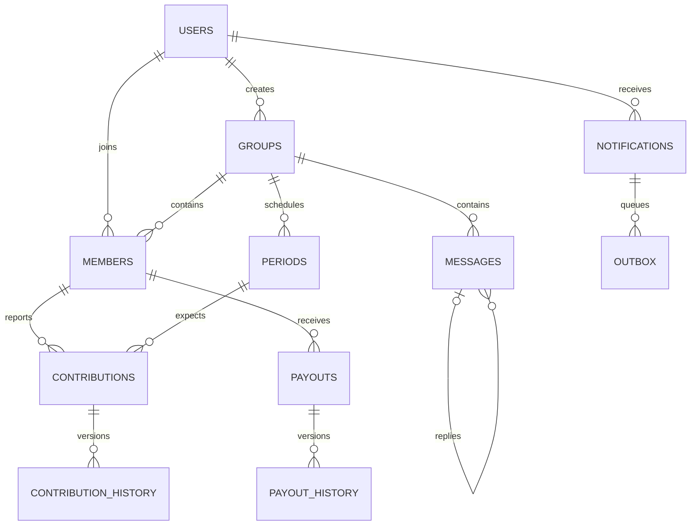

# 2. Data and API contracts

## Implemented storage
PostgreSQL is authoritative. Amounts use integer kobo and NGN semantics. UUID user IDs refer to Supabase `auth.users`; date-only obligations are distinct from timestamped events. `public.profiles` predates tracked migrations. `supabase/bootstrap/000_profiles.sql` now defines a fresh-only prerequisite; it is not an export of the hosted schema. Capture and compare the real hosted DDL/auth trigger before claiming hosted parity.

| Entity | Primary key / significant relationship |
|---|---|
| savings_groups | UUID id; created_by → auth.users; unique(created_by, request_id) |
| group_members | (group_id,user_id); FKs to group/user; one owner per group |
| group_events | UUID id; group and actor FKs |
| group_periods | (group_id,period_number); persisted contribution schedule |
| group_payout_schedule | (group_id,slot); unique(group_id,recipient_id); member FK |
| contributions | (group_id,period_number,user_id); composite period and membership FKs; version; pending/confirmed/rejected |
| contribution_history | UUID id; composite FK to contribution; actor/version/evidence snapshot |
| payouts | (group_id,slot,recipient_id); unique(group_id,recipient_id); member FK; reported/disputed/confirmed |
| payout_history | identity id; composite FK to payout |
| member_profiles | user_id → auth.users; private profile fields; controlled public projection RPC |
| group_bank_accounts | group_id PK/FK; externally supplied account, not issued by AjoPay |
| group_messages | sequence identity PK; group/user; request dedupe; reply_to self-FK |
| group_message_hides | per-user hidden-message association |
| notification_preferences | user_id PK/FK; opt-in channels |
| member_notifications | identity id; user/group/message FKs; unique(user_id,dedupe_key) |
| notification_outbox | identity id; notification FK; unique(notification_id,channel) |

Private receipt bytes live in the `payment-receipts` storage bucket; contributions/history store evidence references. RLS and RPC checks restrict access; table existence does not imply client write permission.



## Current client-facing API catalog
Supabase SDK uses authenticated HTTPS database/RPC calls. RPC HTTP shape is `POST /rest/v1/rpc/<function>` with JSON arguments. JWT identity, membership and server-derived terms govern access; public project credentials alone confer no membership. Internal helper/trigger functions are not public APIs.

| Operations | Current RPCs / access |
|---|---|
| Create/join/details | create_savings_group_v3; join_savings_group; get_group_details |
| Order/consent/activation | prepare_group_order; accept_group_terms; activate_savings_group |
| Account/profile | set_group_bank_account; get_member_profile; own-profile table access |
| Contribution report/review | get_contribution_tracker; submit_contribution_v2; review_contribution |
| Fees | get_late_fees (assessment, not collection) |
| Payout report/acknowledgement | get_payout_tracker; record_payout; acknowledge_payout |
| Chat | list_group_messages; send_group_reply; remove_group_message |
| Notification read state | get_member_notifications; mark_notification_read; mark_chat_read |
| Statement export data | get_group_statement |

Group listing reads membership-scoped `savings_groups`; private profile and preference reads/writes use own-row policies. Authentication uses Supabase Auth, separate from these RPCs. Prior create and contribution RPC versions remain in SQL; audit grants/callers before deprecation.

Example current request (fictional values):
```json
{"p_group_id":"00000000-0000-4000-8000-000000000001","p_period":1,"p_amount_kobo":1000000,"p_reference":"EXAMPLE-001","p_paid_on":"2026-10-22","p_expected_version":0,"p_receipt_path":null,"p_payment_note":null}
```
This is `submit_contribution_v2`, a report of NGN 10,000, not provider evidence. Its response is a tracker object containing `today`, `periods`, `contributions`, `history`; contribution records include status/version. `get_member_notifications` returns `items` and `unread`; `send_group_reply` returns a numeric sequence. Schemas in SQL and Dart parsers remain authoritative; add machine-checkable contract fixtures next.

Current chat pagination: `p_before` sequence cursor, newest 50 returned chronologically within the page. Notifications return recent 100; older-feed pagination is not implemented. Contribution/history trackers aggregate records; add bounded keyset pagination before large histories. Statement dates scope export, not necessarily memory usage.

Current SQL errors include 42501 (authorization), 22023 (invalid terms/state), 23505 (uniqueness/conflict); repositories map failures for UI. Proposed stable application errors: forbidden, invalid_input, conflict_refresh, rate_limited, temporarily_unavailable with retry semantics and correlation IDs. Do not expose SQL internals or sensitive provider bodies. Per-operation rate limiting is not established across all APIs; add user/group limits plus invite-guess protection and 429/Retry-After behavior. Existing `_v2`/`_v3` names provide ad hoc compatibility; formal version/deprecation policy is proposed.

## Proposed payment data and API — not deployed
Entities: payment_intents (UUID, unique reference, user/group/period ownership, expected kobo, test/live domain), provider_events (unique provider event/transaction identity, processing state), ledger_transactions and balanced ledger_entries, payout_intents, reconciliation_runs/discrepancies, identity_verifications (provider reference/status, minimal metadata). Enforce one provider transaction credit globally, not just per webhook event. Never mix sandbox postings with real obligations.

Proposed endpoints: authenticated initialize/status; public provider webhook with signature checks and durable inbox; service-only reconciliation. Derive expected amount, customer and eligibility server-side. Ledger posting and intent transition must be atomic; reversals create compensating entries. Test-only adapter methods are not deployed endpoints and create hosted checkout, not virtual accounts or custody. Account provisioning, withdrawals and KYC contracts require separate partner approval.
