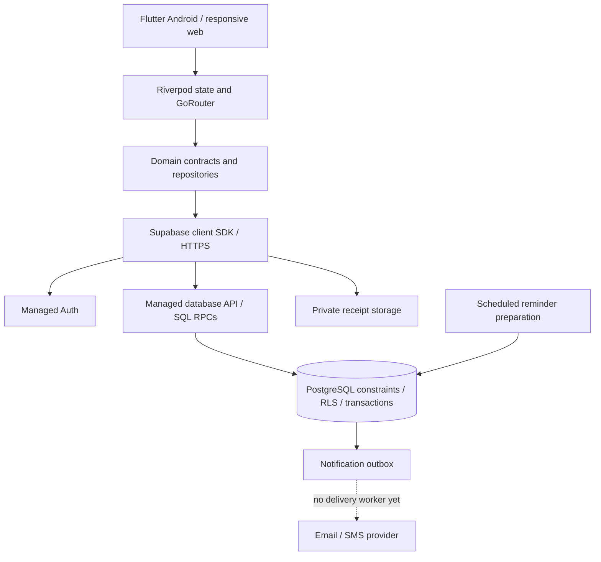
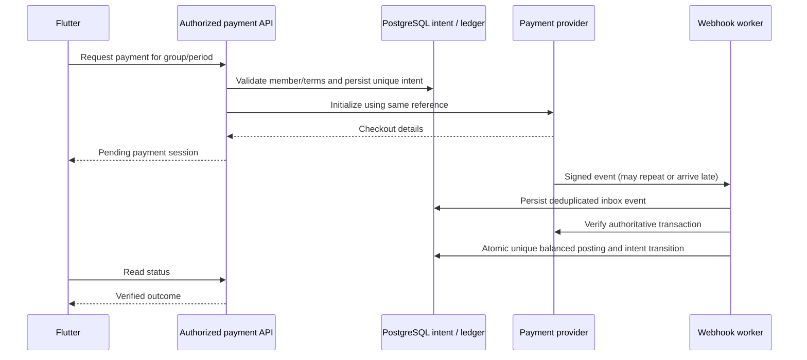

# 3. Component architecture

## Implemented today

Some feature providers/widgets currently call Supabase directly, including notifications/profile/account helpers. Repository separation is a direction and partial implementation, not universal compliance. Refactor feature-by-feature, preserving contracts and behavior.

Managed Supabase ingress/API infrastructure handles platform routing; no AjoPay-operated load balancer or fleet of API servers exists in this repository. Its actual redundancy, limits and service guarantees are unverified here. PostgreSQL persists writes; private storage holds images. The app polls chat and notifications. Riverpod caches client state; it is not a distributed cache, durable queue or authorization authority.

## Proposed payment extension

Only the isolated test-only provider adapter exists. Durable intents, inbox, ledger, worker, endpoints and app session above are proposed. A signed event alone is insufficient: verify transaction reference, amount, currency, customer, mode and status against the persisted intent. A checkout return or “I paid” button may refresh status, never credit funds.

Provider-issued virtual accounts are a later separately approved facility. A shared group account does not inherently identify the paying member. Prefer per-intent identification initially; a permanent user collection account needs explicit allocation if the user joins multiple groups. An account number is not escrow or a guarantee funds are locked until maturity.

## Cache and scaling policy
Proposed: keep short-lived client caches for display data, invalidate after writes and identity changes. Show stale/offline state explicitly. Always check membership and financial state on the server for mutations. Do not serve cached available balances as payout authority.

No Redis layer is currently justified. Add one only after measured repeated read cost demonstrates a benefit; cache keys must include relevant user/group scope, TTL and invalidation version. Do not put secrets or raw identity data in cache. Read replicas may help noncritical historical reads later; current-state financial decisions must use the authoritative database.

External workers may scale horizontally with durable job claims and idempotent processing. A later API fleet sits behind managed ingress; adding servers does not solve a database bottleneck. Prefer query/index/pagination and polling improvements before introducing microservices.
